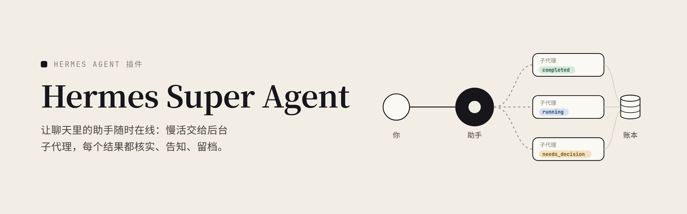
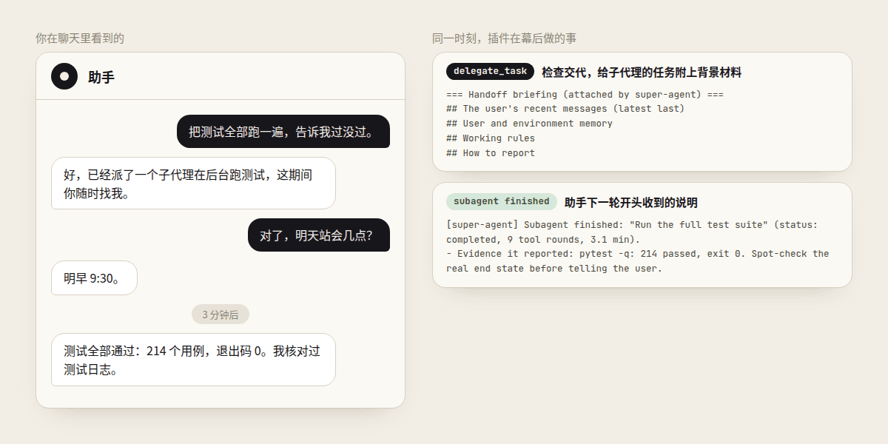
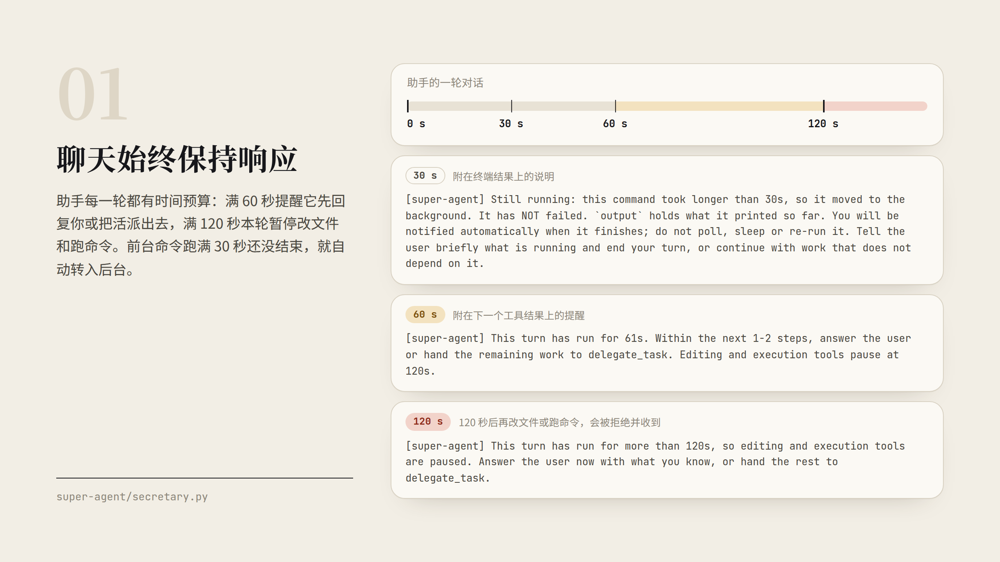
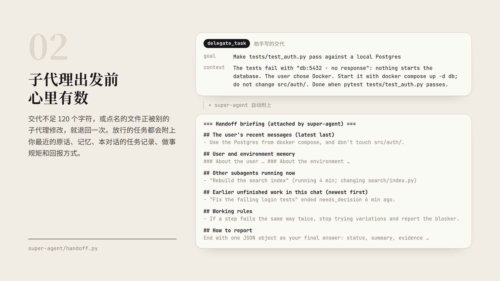
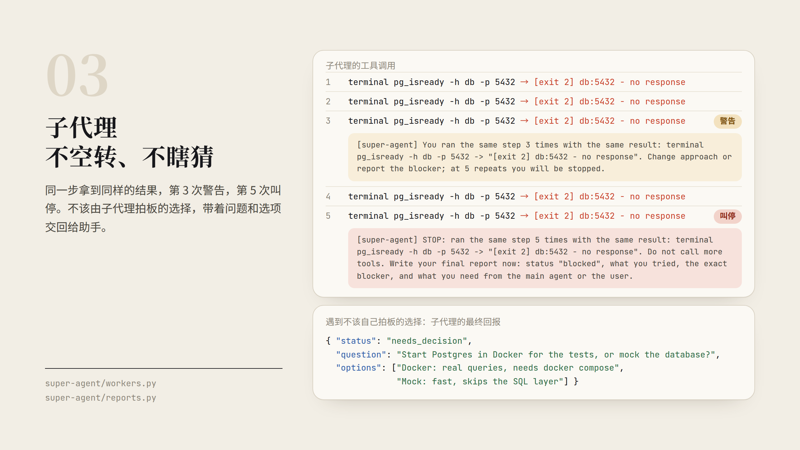
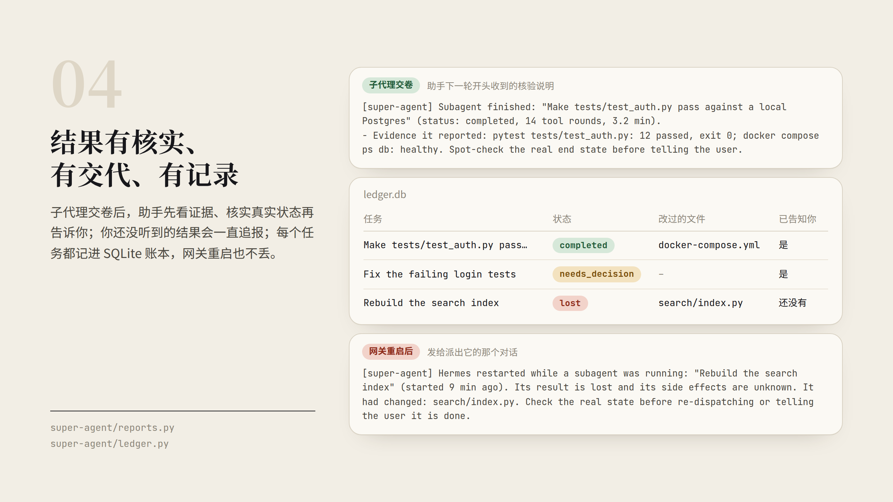

<h1 align="center"></h1>

<p align="center">
<a href="https://github.com/JerryLiu369/hermes-super-agent/releases"></a>
<a href="https://github.com/JerryLiu369/hermes-super-agent/actions/workflows/ci.yml"></a>
<a href="https://hermes-agent.nousresearch.com/docs/plugins/super-agent"></a>
<a href="https://www.python.org/"></a>
<a href="LICENSE"></a>
</p>

<p align="center"><a href="README.md">English</a> · 简体中文</p>

[Hermes Agent](https://hermes-agent.nousresearch.com) 的插件，把聊天里的一个助手变成一支小团队：**助手**像一位靠谱的秘书，把耗时的慢活交给后台的**子代理**去跑，自己随时在线响应；每件活做完，结果都会先核实、确实转达给你，并记入账本留档。

插件专为在聊天软件里使用 Hermes 而写。它完全由普通 Python 代码运行，自己不调用任何模型，也从不直接往聊天窗口发消息；你看到的每一句回复，依然都出自助手。



## 安装

```bash
hermes plugins install JerryLiu369/hermes-super-agent/super-agent
hermes plugins enable super-agent
```

建议在 `~/.hermes/config.yaml` 中顺手加上下面两项可选配置，改完后重启网关：

```yaml
delegation:
  max_iterations: 90                # 需要更多步数的子代理，多半已经卡住了
plugins:
  entries:
    super-agent:
      allow_gateway_injection: true # 允许插件唤醒助手，把被你新消息打断的汇报补上
```

不开 `allow_gateway_injection` 也不影响日常使用，被你打断的汇报会等你发下一条消息时再一并补上。如果安装时用了别的插件名，请把配置里的 `super-agent` 换成 `hermes plugins list` 显示的实际名称。

### 从 `proactive-agent` 升级

从 0.2.0 起，`hermes-proactive-agent` 改名为 Hermes Super Agent。功能不变，只是名字换了。

1. 按上面的命令安装并启用 `super-agent`，再停用旧插件：`hermes plugins disable proactive-agent`。
2. 把 `~/.hermes/config.yaml` 里的 `plugins.entries.proactive-agent` 改名为 `plugins.entries.super-agent`。
3. 想保留任务记录的话，首次启动前把 `<hermes home>/plugin-data/proactive-agent/ledger.db` 复制到 `<hermes home>/plugin-data/super-agent/ledger.db`。
4. 环境变量改用 `SUPER_AGENT_<配置名大写>`；旧的 `PROACTIVE_<配置名大写>` 仍然有效。

## 为什么要做这个

Hermes 本身就能把任务派给子代理在后台执行。但真正在聊天软件里用起来，常会遇到这六件糟心事：

- **聊天动不动冷场。** 助手自己跑起构建，或者一头扎进长链路排查，聊天窗口里十分钟没有半点回音。
- **子代理出发时两眼一抹黑。** 子代理看不到聊天记录也没有记忆，你交代过什么、之前试过什么、哪些东西千万不能碰，它一概不知。
- **卡住的子代理要么死循环，要么乱猜。** 同一个报错的命令翻来覆去地跑，直到把步数耗光；或者遇到不该由它拍板的分岔路口，自己随便猜一个往下走。
- **所谓“做完了”全凭自报。** 子代理说搞定了，助手就原话转告，没有证据也没有核验。
- **刚好赶上你发消息，结果就漏报了。** 后台结果刚送回来，你恰好发来一条新消息；助手只顾着回你这句话，刚才做完的任务就再没人提起。
- **任务一结束或网关一重启，前因后果全丢。** 子代理退场后，或者 Hermes 网关重启后，它刚才查到了什么、动过哪些文件，全都无从查起。

接下来的四节，按顺序说明插件如何逐一解决这些问题。

## 它做了什么

### 聊天始终保持响应



助手的每一轮对话都有时间预算：

- **满 60 秒时**，助手会收到一次提醒：在一两步之内先回复你，或者把剩下的慢活通过 `delegate_task` 派给子代理。
- **满 120 秒后**，当前这一轮暂停修改文件和执行命令。助手仍然可以读文件、看图（`vision_analyze`）、搜索、派发任务，或使用收尾工具：`memory`、技能类工具、`todo_list`、`clarify`，以及用 `process_manage` 查看（`list`）、轮询（`poll`）、读日志（`log`）或终止（`kill`）后台任务。
- **你在一轮中途发来新消息时**，计时立即归零重算，给助手留出处理新消息的时间。
- **上下文压缩不计时。** Hermes 在一轮中途压缩对话时，计时会暂停到摘要生成完毕，不会因为一次漫长的压缩就让助手直接进入 120 秒的暂停。

耗时命令同样不会拖住聊天。前台终端命令运行满 **30 秒**仍未结束时，插件会借助 Hermes 自带的让出机制（yield）将它转入后台（限 Hermes 的本地终端后端，只有它能把运行中的进程交给后台）：进程照常运行，结束时由 Hermes 通知助手，同时插件会明确告知助手“命令仍在后台运行，并非执行失败”。此外，插件会拒绝 `process_manage(action='wait')`，防止助手在原地干等后台任务而再次卡死聊天。

### 子代理出发前心里有数



子代理看不到聊天上下文，也没有记忆，全靠助手在派活时写好任务交代（`context`）。插件会在 `delegate_task` 发出前做一次把关；遇到下面两种情况，**每轮会退回一次**并说明原因：

- 任务交代不足 **120 个字符**，插件会提示助手补齐已知信息、具体目标路径或地址、禁止改动的部分、何时停手，以及怎样才算完成；
- 任务里点名要改某个文件，而另一个正在运行的子代理已经在改它，避免两个子代理互相覆盖。

同一轮里的第二次提交一律放行。凡是放行的任务，插件都会在助手写的交代后面自动附上一份背景材料：

- **你最近 6 条消息的原话**，像“别动 X”这类叮嘱能一字不差地传给子代理。
- **`USER.md` 和 `MEMORY.md`**，补上 Hermes 默认不给子代理加载的用户与环境记忆。这两个文件会原样整份附上，里面记着的关于你的信息（包括个人信息），受管的子代理都看得到。
- **当前正在运行的其他子代理**，以及它们正在修改的文件列表。
- **当前对话里最近未完成的任务记录**（查到了什么、卡在哪里、提过什么问题、收到过哪些 `steer` 纠正、改过哪些文件、完整日志路径在哪），让接手的子代理直接接着往下做，不必从头再探一遍路。
- **几条做事规矩**：只做分内的事；同样的错连犯两次就停；遇到不该自己定的事带回来问，不瞎猜；命令被拦截时不绕路硬闯；高风险改动必须留有回滚路径；不碰别的子代理正在改的文件；报完成之前先核实真实状态。
- **回报方式**：最后交一个 JSON 对象，包含 `status`（`completed`、`partial`、`blocked`、`needs_decision` 或 `failed`）、`summary`、`evidence` 和 `blockers`，需要拍板时再附上 `question` 和 `options`。这只是要求，不做强制校验：插件不设置 `output_schema`，所以 Hermes 不需要 `jsonschema`，也不会让子代理返工重写。插件能读到 JSON 就按 JSON 处理（放在代码块里也行）；纯文字回报里只要写了 `needs_decision`，照样算作需要拍板；其他情况交给助手自己读。如果任务本身指定了 `output_schema`，则原样保留。

### 子代理不空转、不瞎猜



Hermes 能发现子代理在重复调用工具，但对子代理只提醒、不制止。插件会在子代理的整个运行周期内累计计数（不限于连续重复），并按结果的第一行做比对；长数字和哈希会先抹平，因此就算每次请求 ID 或时间戳不同，只要报错一样就记为同一次重复。当子代理用同一个工具、同样的参数，拿到同样的结果时：

- **第 3 次**：收到警告，要求换思路或直接上报阻碍；
- **第 5 次**：直接叫停，后续工具调用一律拒绝，子代理只能以 `blocked` 状态交卷。

总步数上限则继续由 Hermes 的 `delegation.max_iterations` 把控。

子代理也没法直接向你提问：Hermes 没有给它开放 `clarify` 工具，而且子代理一旦结束就无法恢复。为了不让它瞎猜或硬闯，遇到以下两种情况时，子代理会停下来并以 `needs_decision` 状态回报，附上明确的问题（`question`）和可选项（`options`）：

- **遇到不该由它拍板的选择**：比如两套方案都走得通、要改动生产环境、涉及花钱或删数据、或者做高风险操作却没有回滚手段，而任务交代里又没写明怎么办。如果它漏写了问题，插件会提醒助手去读它的总结。
- **某一步被命令审批或 hook 拦下**，或者卡在一个当前运行里没人能批的审批上。子代理会当场收到提示（若是被 hook 拦下，提示会附在它的下一个工具结果上）：不要重试、不要改写命令、更不要换条路去达到同样的效果；如果任务非它不可，就以 `needs_decision` 把问题带回来。由于某些配置下 Hermes 会自动拒绝子代理的危险命令并显示“用户已拒绝”，提示里也会说明这可能是系统自动拦截，未必是你本人点了拒绝。

当 `needs_decision` 回报送到助手手里时，助手看得到完整对话和记忆：如果答案在前面的聊天、记忆或它能直接查到的事实里已经很清楚，助手会自己拍板；如果确实需要你拿主意（个人偏好、风险取舍、花钱、被拒的危险命令），它会发一条简短的消息把选项列给你。无论哪种方式，拿到答案后助手都会带着决定和前一个任务的记录，重新派一个子代理接着做。要是你已经看到了问题，而到你发下一条消息时助手还没派活跟进，插件会在那条消息里提醒助手一次。

### 结果有核实、有交代、有记录



子代理一结束，助手的下一轮对话开头就会收到一条核验说明：

- 子代理报 `completed` 且附有证据时，列出这些证据，提醒助手在向你报喜前先抽查真实状态；
- 子代理空口说完成却没给证据、没做完，或因原地打转被插件叫停时，直接标出警告；如果是因重复被叫停，还会要求助手用一句话告诉你卡在了哪里、接下来准备怎么办；
- 助手自己用 `action='stop'` 主动喊停的任务，会注明是主动停止，不作失败处理。

后台子代理的结果会通过单独的一轮内部唤醒交给助手。如果这轮汇报还在跑的时候你刚好发来新消息，Hermes 会把你的消息并进同一轮，助手往往只顾着回答你的新问题，把刚才跑完的结果忘在一边。为了防止漏报，插件会一直把后台结果标记为**尚未告知你**（`unreported`），直到展示过该结果的那一轮以一次未被你打断的回复顺利结束：

- **如果你发消息后助手又调用了工具**，工具返回时会附带提醒：回答你的问题，并在同一条回复里把后台结果一并汇报；
- **如果助手没再调工具就直接回复了你**，插件会通过 Hermes 的消息注入机制再唤醒助手一次（排在当前轮次之后，绝不插队打断），让它补发一条简短的结果说明；如果上一条回复里其实已经讲过了，助手只需回复 `[SILENT]` 即可静默结束；
- **如果那一轮被 Hermes 直接中断，或未开启唤醒权限**，提醒会自动挂在你发出的下一条消息上。

这期间你每多插进来一条消息，都会触发一次新的提醒，连发几条消息也不会把结果冲掉。每个结果最多触发 **2 次**唤醒，超过 **24 小时**的旧结果不再追报。

最后，每一个派出的任务都会写入 `<hermes home>/plugin-data/super-agent/ledger.db` 的 SQLite 账本：记录任务目标与状态、改过的文件、中途通过 `action='steer'` 发出的纠正、实时日志路径、结项详情（摘要、证据、阻碍、待定问题与选项），以及结果是否已经同步给你。因为 Hermes 不能恢复已结束的子代理，同一个对话里派出的下一个子代理会自动在背景材料里拿到前序未完成任务的记录。如果 Hermes 网关在子代理运行中途重启，插件会把这些任务标记为丢失，并在下一轮明确告诉助手哪些任务中断了、它们动过哪些文件、副作用尚不明确，提醒助手先核实现场再决定是否重派。待发送的提示和尚未告知你的结果也保存在账本中，重启不会丢失。账本为每个对话保留最近 **20 个**已结束的任务，最长保留 **7 天**。

## 设计原则

- **只跟助手说话。** 插件只在助手的上下文里附加说明；为了补齐被你打断的汇报，也只是发一条内部消息唤醒助手。它从不直接往你的聊天里发消息，跟你说什么完全由助手决定。
- **不搞定时播报。** 没有进度条，也没有定时心跳。每一条提示都由具体的事件触发（一轮开始、工具返回、子代理结束、或一轮结束时仍有结果未告知你），并且只投递一次。
- **零模型调用。** 所有检查都是确定性的普通代码，本身不消耗任何 token。
- **Hermes 的职责仍归 Hermes。** 危险命令审批、过期文件保护、总步数上限、循环提醒，以及把子代理结果送回助手，都继续由 Hermes 负责。插件只补齐它留下的空白。
- **只走公开接口。** 插件只通过 Hermes 的钩子、中间件和插件 API 工作，从不改写 Hermes 自身的代码，因此能通过插件目录的准入检查，也不会和其他插件互相冲突。
- **绝不添乱。** 所有钩子都有异常保护：万一插件自己出错，只记一行日志，绝不阻断正常的工具调用。
- **只在你指定的地方生效。** 只有 `governed_platforms`（默认 `["weixin"]`）里列出的平台，以及从这些平台派出的子代理才受插件管理。定时任务、命令行和其他平台一概不碰。

## 配置

配置项写在 `~/.hermes/config.yaml` 的 `plugins.entries.super-agent.settings` 下：

```yaml
plugins:
  entries:
    super-agent:
      allow_gateway_injection: true   # Hermes 宿主权限，详见“安装”一节
      settings:
        governed_platforms: ["weixin"]
        turn_soft_seconds: 60
        turn_hard_seconds: 120
        terminal_auto_detach_seconds: 30
        handoff_min_context_chars: 120
        worker_repeat_limit: 5
```

| 配置项 | 默认值 | 作用 |
|---|---|---|
| `governed_platforms` | `["weixin"]` | 受插件管理的聊天平台（含从这些平台派出的子代理） |
| `turn_soft_seconds` | `60` | 单轮运行满多少秒时，提醒助手尽快回复或派活 |
| `turn_hard_seconds` | `120` | 单轮运行满多少秒后，在本轮剩余时间内暂停修改文件和跑命令 |
| `terminal_auto_detach_seconds` | `30` | 前台终端命令运行超过多少秒后自动转入后台（填 `0` 关闭） |
| `handoff_min_context_chars` | `120` | `delegate_task` 中 `context` 的最短字符数，不足时每轮退回一次 |
| `worker_repeat_limit` | `5` | 子代理重复相同步骤并拿到相同结果满几次后叫停（提前两次先提醒） |

所有配置项都可以通过同名环境变量 `SUPER_AGENT_<配置名大写>` 覆盖（例如 `SUPER_AGENT_TURN_SOFT_SECONDS=45`），环境变量优先级高于配置文件。没设 `SUPER_AGENT_` 版本时，旧的 `PROACTIVE_<配置名大写>` 依然会被读取。填入无效值时只会记录一条日志并自动忽略。

## 常见问题

**会多花 token 吗？**
插件自己不调用任何模型，只是在助手上下文和子代理背景材料里附上几段简短说明。为了补上被你打断的汇报而唤醒助手时，相当于助手多跑一轮简短回复，开销和你自己多发一条消息差不多。

**会影响定时任务、命令行（CLI）或其他聊天平台吗？**
不会。只有列在 `governed_platforms` 里的平台及其派出的子代理受插件管理，定时任务和其他平台完全按原样运行。

**它会取代 Hermes 自带的命令审批或循环检测吗？**
不会，这两项机制照常工作。当 Hermes 的审批拦下子代理的命令时，插件只是及时提醒子代理不要绕路硬试，而是把问题带回来交给助手处理。

**怎么让聊天在长命令或多步任务进行时不卡死？**
装上并启用 `super-agent`。满 60 秒时助手会收到一次提醒：先回复你，或者把剩下的活派给子代理；满 120 秒后，本轮不再允许改文件和跑命令，但读文件、搜索、派活照常。终端命令跑满 30 秒会自动转入后台，插件也会拒绝助手原地等后台任务，所以一次长时间的构建拖不住聊天。

**`delegate_task` 派出的子代理为什么不知道 `MEMORY.md` 和刚说过的话？**
Hermes 派子代理时不带聊天记录，也不给它加载用户和记忆文件，子代理本身看不到这些。凡是放行的任务，插件都会在后面附一份背景材料：你最近 6 条消息的原话、`USER.md` 和 `MEMORY.md`、正在运行的其他子代理及其正在改的文件、本对话最近的未完成任务、几条做事规矩，以及回报方式。

**子代理遇到该由你拍板的选择，或者命令被拦下时怎么办？**
它没法直接问你：Hermes 没给子代理开放 `clarify` 工具，子代理一旦结束也无法恢复。所以它会停下来，以 `needs_decision` 状态回报，附上一个明确的问题和可选项；某一步被审批或 hook 拦下时同样如此，并且会当场收到提示：不要重试，也不要绕路。助手能根据聊天或记忆定的就自己定，确实要你拿主意的就发一条简短消息把选项列给你，然后带着答案重新派一个子代理。

**我在后台子代理刚跑完的时候发消息，会发生什么？**
Hermes 会把你的消息并进那轮汇报里，助手往往只顾回答你，把刚跑完的结果忘在一边。插件会一直把结果标成 `unreported`，直到展示过它的那一轮以一次没被你打断的回复结束：助手若又调了工具，工具返回时会提醒它一并汇报；若它没调工具就直接回复了，插件会通过 Hermes 的消息注入再唤醒它一次（需要开启 `allow_gateway_injection: true`），补一句简短说明或回 `[SILENT]`；两种情况都不成立时，提醒会挂在你下一条消息上。

## 兼容性

- **Hermes Agent** 0.22 及以上（已在 v0.22.7 上验证）。
- 长命令转后台需要 Hermes 保持默认的 `plugins.isolation: in_process`；设为 `host` 时，命令只会照常在前台运行。
- **Python** 3.10 及以上，零运行时依赖。
- **CI** 在 Python 3.10 至 3.14 上运行 `ruff check` 与 `pytest`。

## 开发

```bash
uv run --group dev pytest
uv run --group dev ruff check
```

当环境中可以导入 `hermes_cli` 时，`tests/test_hermes_e2e.py` 会通过真实的 Hermes 插件加载器运行端到端测试；否则会自动跳过。

```text
super-agent/      插件安装目录（Hermes 唯一会复制的目录）
├── secretary.py      单轮时间预算、30 秒长命令转后台、中途新消息处理
├── handoff.py        派活任务把关、背景材料拼接、做事规矩与回报方式
├── workers.py        运行中子代理登记、重复步骤叫停、命令被拒时的提示
├── reports.py        结果核验说明、待拍板问题、未送达结果追报、重启后恢复
├── ledger.py         SQLite 任务账本与持久化提示队列
├── prompt.py         受管助手的系统提示词片段
├── context.py        调用方身份识别（受管助手、子代理或定时任务）
├── config.py         配置读取与默认值
├── util.py           文本、JSON 与调用签名辅助函数
├── __init__.py       钩子注册与路由
├── plugin.yaml       Hermes 插件清单与配置定义
└── README.md         Hermes 插件商店页面上显示的精简说明
tests/                按模块对应的单元测试，以及基于真实 Hermes 的端到端测试
assets/               README 与插件商店用的图片，用 src/make.sh 重新生成
```

## 给 AI 读的文档

[llms.txt](llms.txt) 是面向 AI 代理和答案引擎的精简索引，[llms-full.txt](llms-full.txt) 则在单个文件中收录了完整的项目技术参考。

## 许可证

[MIT](LICENSE)
