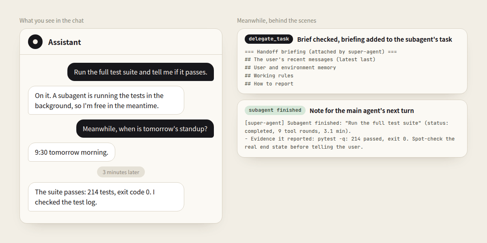

# Hermes Super Agent

Runs your Hermes chat like a good secretary with a team of workers. The **main agent** stays reachable in the chat while **subagents** do the slow work in the background, and every delegated job ends with a result that is checked, reported to you and recorded. Plain Python: no model calls of its own, and it never writes into your chat.



## Install

```bash
hermes plugins install JerryLiu369/hermes-super-agent/super-agent
hermes plugins enable super-agent
```

Optional, in `~/.hermes/config.yaml` (restart the gateway after changing it):

```yaml
plugins:
  entries:
    super-agent:
      allow_gateway_injection: true # lets the plugin wake the main agent to finish a report you interrupted
```

By default it governs `weixin` chats and the subagents they spawn; set `governed_platforms` to choose others.

## What it does

- **The chat stays responsive.** At 60 seconds in one turn the main agent is reminded to answer or delegate, and at 120 seconds editing and running commands pause for the rest of the turn. A terminal command still running after 30 seconds moves to the background.
- **Subagents start informed.** A brief under 120 characters, or one naming a file another running subagent is changing, goes back once. Every accepted task gets your last 6 messages, `USER.md` and `MEMORY.md`, the chat's task record, working rules and how to report. When you write while subagents run, the main agent is reminded which ones, so a change reaches them with a steer.
- **Subagents do not spin or guess.** The same step with the same result draws a warning the 3rd time and a stop the 5th. A choice that is not the subagent's to make comes back as a `needs_decision` question with options. After 2 subagents end without finishing since your last message, the next dispatch goes back once so the main agent asks you first.
- **Results are checked, reported and remembered.** The main agent is told to check a result's evidence before passing it on (a subagent that ends without its report is not taken as done), a background result stays unreported until you have heard it, and every task is kept in a SQLite ledger that survives a gateway restart.

`hermes super-agent status` shows the settings in effect and the latest tasks. Settings, the full explanation and a FAQ are in the [README](../README.md) ([简体中文](../README_zh.md)).

MIT licensed.
